# The ARK — User Guide

**The ARK: Academic Records Keeper.** The RVNP ICT Department's system for attendance, marks and POE evidence.
Applies to app version 4.17.2 (server 6.5, Drive bridge 1.4.2). The screenshots show an invented demo department.

The ARK is two apps that work on any phone, tablet or computer with a modern browser:

| App | Address | Who uses it |
|---|---|---|
| **The ARK** (staff app) | https://musumbidenis.github.io/tt/ | Trainers, HODs and the MIS Officer |
| **Student-POE** (student app) | https://musumbidenis.github.io/tt/student.html | Students |

Both apps keep working with **no internet**. Everything you do is saved on the device straight away and sent to the college database the next time the device is online.

---

## Contents

1. [Getting started](#1-getting-started)
2. [Finding your way around](#2-finding-your-way-around)
3. [Trainers: marking attendance](#3-trainers-marking-attendance)
4. [Lesson QR codes and ID cards](#4-lesson-qr-codes-and-id-cards)
5. [Reports: the term register](#5-reports-the-term-register)
6. [Marks (continuous assessment)](#6-marks-continuous-assessment)
7. [POE evidence: reviewing students' work](#7-poe-evidence-reviewing-students-work)
8. [Absences (HOD and MIS Officer)](#8-absences-hod-and-mis-officer)
9. [HOD tasks](#9-hod-tasks)
10. [MIS Officer tasks](#10-mis-officer-tasks)
11. [Your Profile](#11-your-profile)
12. [Students: the Student-POE app](#12-students-the-student-poe-app)
13. [Working offline and keeping data safe](#13-working-offline-and-keeping-data-safe)
14. [Troubleshooting and questions](#14-troubleshooting-and-questions)
15. [Asking for a change to a screen](#15-asking-for-a-change-to-a-screen)

---

## 1. Getting started

### 1.1 Install the app on your phone

Do this once, **while you have internet**.

**Android (Chrome, Edge or Samsung Internet)**
1. Open the app's address (see the table above).
2. Open the browser menu (**⋮**) and choose **Add to Home screen** or **Install app**.
3. From now on, open The ARK from its icon on the home screen.

**iPhone or iPad (Safari)**
1. Open the address in **Safari**.
2. Tap **Share**, then **Add to Home Screen**.
3. Open the app from the Home Screen from now on.

Installing matters: the browser then keeps the app's data permanently, and on iPhones it is the only way to get notifications.

### 1.2 Sign in (staff)

1. Open The ARK. The sign-in screen asks for your **staff code** (for example `ICT020`) and **PIN**.
2. Use the PIN the MIS Officer gave you, or the department's **first-time PIN** if you have not chosen your own yet.
3. The first time, the app asks you to **choose your own PIN**: 4 to 8 digits. Easy PINs such as `1234`, `0000` or `9876` are refused.
4. Your classes and class lists download straight away. After that, marking works with or without network.

| Good to know | |
|---|---|
| Wrong PINs | Five wrong PINs in a row lock that staff code for 15 minutes. |
| Signed out everywhere | If the MIS Officer resets your PIN or switches your account off, you are signed out on every device. Nothing saved on the device is lost: sign in again and it carries on. |
| Changing your PIN | **Profile → Change PIN** at any time. |
| Forgot your PIN | Only the **MIS Officer** can reset a PIN. |

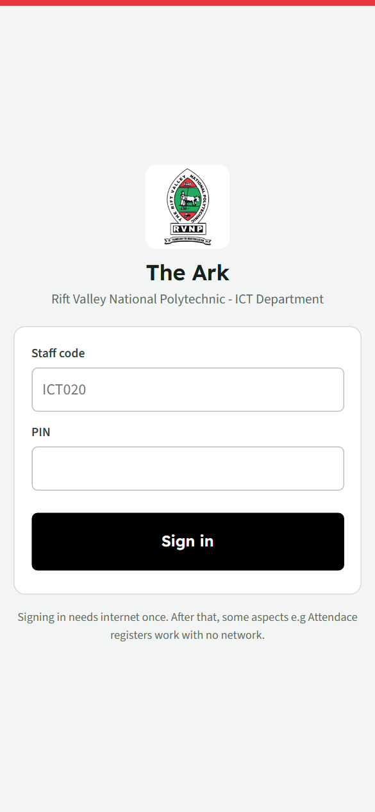

### 1.3 Who can do what

| Role | What they can do |
|---|---|
| **Trainer** | Mark registers for the classes and units in their loading (also offline). Add a student who is not on the list. Show a lesson QR code and scan students' QR IDs. Enter marks. See, export and submit their units' term registers. Review the POE evidence students send for their units. |
| **HOD** | Everything a trainer can do for their own units, plus: approve or return term registers, see every class's register, the department overview and the Absences list, and unlock a register or marks from a term that has ended. |
| **MIS Officer** | Set up the term, upload the trainer loading and class lists, approve students added by trainers, manage staff, PINs and roles, receive approved POE evidence, see the Absences list, unlock ended terms, connect Google Drive, and archive or delete classes. |

One person can hold several roles, for example an HOD who also teaches.

### 1.4 Practising on the demo copy

There is a separate **demo copy** of both apps for training sessions. It works exactly like the real app but holds only invented classes, students and registers, so you can try anything (mark, scan, approve, reset) without touching real records. Your trainer or the MIS Officer gives you its address, a demo staff code (DEMO01 to DEMO10, or MIS) and the PIN. Students choose any name on a demo class list.

- Both demo apps show an orange **DEMO** tag beside the app name. If you see it, nothing you do counts.
- The demo is wiped and filled again before each training session.
- For a training session in pairs (one partner the trainer, the other the student, then swap), use the handout at https://musumbidenis.github.io/tt/demo/demo-day.html.

---

## 2. Finding your way around

### 2.1 The tabs

| Tab | Who sees it | What it is for |
|---|---|---|
| **Att Register(s)** | Trainers and HODs | Choose a lesson on the weekly timetable and mark the register. |
| **Report(s)** | Everyone | Term registers (Attendance) and marksheets (Marks). |
| **POE** | Everyone | Students' evidence: review, approve, return, receive. |
| **Absences** | HOD and MIS Officer | Students who have missed more lessons than the limit you set. |
| **Manage** | HOD and MIS Officer | Approvals, the department overview, term, loading, class lists, staff and Google Drive. |
| **Profile** | Everyone | Your PIN, how attendance is counted, class lists, backups. |

A **red dot** on a tab shows how many things are waiting for you (evidence to review, students over the absence limit, requests in Manage).

On a **phone** the tabs run along the bottom of the screen. On a **computer or a tablet held sideways** they become a side bar on the left.

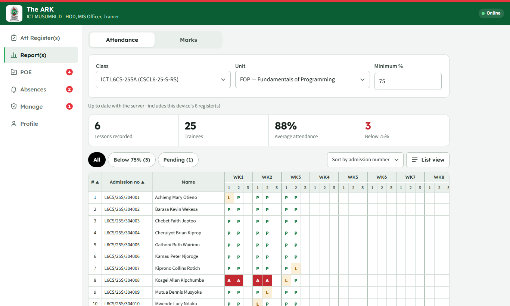

<em>On a computer: the side bar, and a term register in sheet view.</em>

The header shows **The ARK**, your name and your roles (for example *ICT MUSUMBI .D - HOD, MIS Officer, Trainer*), and whether the device is **Online** or **Offline**.

### 2.2 Tables

All long tables behave the same way:

- **30 rows to a page.** Use **‹ Previous** and **Next ›**, or choose 10, 25, 30, 50 or 100 rows under the table.
- **Sort** by tapping a column heading; tap it again to reverse. Lists that are not tables have a **Sort** choice instead.
- **Search** boxes filter as you type.
- **Exports** (Excel and PDF) always contain every row that matches your filters, not just the page on screen.

---

## 3. Trainers: marking attendance

### 3.1 Choose the lesson

Open **Att Register(s)**.

1. **Class** and **Unit**: only the ones in your loading are offered.
2. **Week**: starts on the current teaching week, written like *Week 5 (Oct 5 - Oct 9)*. A CAT week says *· CAT week*.
3. **Register for**: **Lesson**, **CAT** or **Extra CAT attendance**.
   - **CAT** is only possible in the CAT weeks the MIS Officer set. In a CAT week, **Lesson** is switched off.
   - **Extra CAT attendance** can be taken in any week. Give it a title, for example *CAT 1 make-up*.
4. **The timetable** shows the week: the five days run down the side and the six lessons run across the top.

   | Lesson | Time |
   |---|---|
   | 1 | 7:30 - 9:00 |
   | 2 | 9:00 - 10:30 |
   | 3 | 10:30 - 12:00 |
   | Lunch | 12:00 - 13:00 |
   | 4 | 13:00 - 14:30 |
   | 5 | 14:30 - 16:00 |
   | 6 | 16:00 - 17:30 |

5. **Tap the slot** where the class was. It turns green.
   - For a **double**, tap the next slot as well (both in the morning, or both in the afternoon).
   - **Lunch** can be chosen for a CAT or extra attendance, never for a lesson.
   - Slots already marked show **Marked** (or **Double**, or the CAT's name) with the number present. Tap one to open that register again.
   - A slot used by another class or unit shows its name in small letters.
   - Days that have not come yet cannot be chosen.
6. Tap **Open register**.

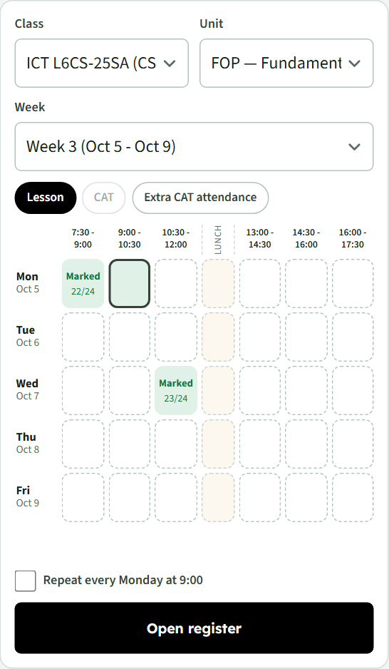

<em>Two lessons already marked; a free slot chosen, ready to open.</em>

**Rules the timetable follows**

- A unit can have up to **3 lessons a week**; a double counts as two. This matches the register's 3 cells per week.
- Only the term's **12 teaching weeks** can be marked (break weeks are skipped).

**Repeat a slot every week.** After choosing a lesson slot, tick **Repeat every Wednesday at 7:30** (for example). From then on, whenever you reach a week where that slot has no register yet, it is already chosen: just tap **Open register**. Untick it to stop. This is kept on the device you set it on.

### 3.2 Mark the register

| Action | How |
|---|---|
| Mark one student | Tap **P** (Present), **A** (Absent), **L** (Late) or **E** (Excused). Each tap is saved at once. |
| Mark everyone | **All present** or **All absent**. |
| Find a student | Type in the search box (name or admission number). |
| Change the order | The **Sort** choice: by name, by admission number, or absent first. Your choice is remembered. |
| Long classes | 30 students to a page, each with a serial number (S/N). |
| Notes | Type what was covered or any remarks. |
| Finish | **Save register**, then **Close**. |

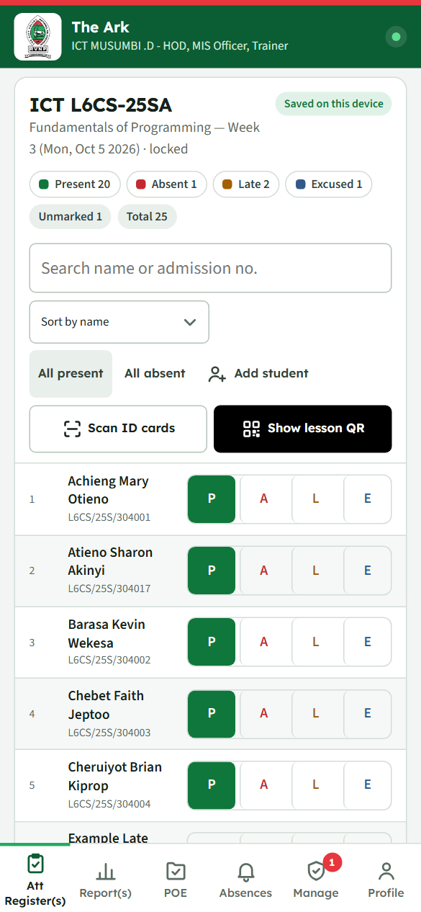

The box at the top right of the register says whether it is **Saved on this device** and the counts show how many are present, absent, late and excused.

**A new register starts with everyone present** (you can change this to everyone absent under **Profile → How attendance is counted**).

**Students who are not on the list.** Tap **Add student**, enter the admission number, full name and reason, and choose how to mark them. They are marked straight away and show as **Pending** until the MIS Officer approves them.

**Locked registers.**
- A register becomes **locked** a set number of hours after it was made (48 by default; see **Profile**). Changing a locked register asks you for a reason, which is recorded.
- A register from a **term that has ended** cannot be changed at all, unless the HOD or MIS Officer unlocks it (see [9.3](#93-unlocking-an-earlier-terms-registers-and-marks)).

### 3.3 Sending registers

There is no Send button: registers are sent **automatically** whenever the device is online. If a register has been waiting for two days or more, a warning appears at the top of the app. **Profile → Class lists** shows when registers were last sent.

### 3.4 Using more than one device

You can sign in on several devices, for example a phone and a laptop.

- Each device brings down the registers you made on your other devices, so the timetable shows them everywhere.
- If two devices change the same register, each student keeps the **latest** mark, wherever it was set. One device cannot wipe out another's work.
- Personal choices such as the repeating slots and the register's sort order stay on the device where you set them.

---

## 4. Lesson QR codes and ID cards

### 4.1 Show a lesson QR code (students check themselves in)

1. Open today's register and tap **Show lesson QR**.
2. A large code appears. It is made on your device, is unique to this lesson and **changes every 20 seconds**, so a photo of it is useless later.
3. Students scan it with the Student-POE app or their normal camera. Each check-in appears on your register within seconds once the student's device is online.
4. In a QR lesson, students who do not scan count as **absent** unless you mark them yourself.
5. Tap **Close** when you are done.

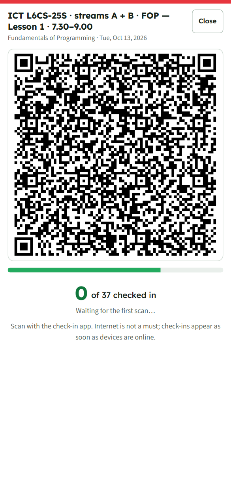

Neither you nor the students need internet during the lesson. The server checks every check-in against your record of which codes were shown and when; a forged, old or other-lesson code is refused, even if it arrives months later.

A student from another class is refused on their own device. In a combined lesson (two classes on one loading row), students of both classes can check in.

### 4.2 Scan students' QR IDs

Every student's QR ID is shown in their Student-POE app (on their profile).

1. In the register, tap **Scan ID cards**.
2. Everyone not already marked by hand starts as **Absent**. Choose **Mark scanned trainees as** Present or Late.
3. Point the camera at each student's QR ID. Each one is marked as it is read.
4. Tap **Done**.

---

## 5. Reports: the term register

Open **Report(s)** and choose **Attendance** at the top.

### 5.1 Choose what to see

- **Term**: the current term is chosen. Earlier terms can be chosen to look back (this needs internet).
- **Class** and **Unit**: trainers see their own units; the HOD and MIS Officer see every class.
- **Minimum %**: the attendance below which a student is flagged (75% to start).

### 5.2 What it shows

- **Four cards**: lessons recorded, number of trainees, average attendance, and how many are below the minimum.
- **List view** (phones): one row per student with a strip of the 12 weeks × 3 lessons (green present, amber late, red absent, blue excused), their percentage and their Actual/Possible hours.
- **Sheet view** (tablets and computers, or a phone turned sideways): the full grid, laid out like the Excel class register. Tap a heading (Admission no, Name, Possible hrs, Actual hrs, %) to sort.
- **Filters**: **All**, **Below 75%**, **Pending**.
- **Sort**: by admission number (the default), by name, or lowest % first.
- **Legend**: the colours, and how Late and Excused are counted, for example *Late counts - 50%, Excused counts - 100%*.
- A class with no students says **No trainees in this class yet** instead of showing an empty table.

**How hours are counted.** Possible hours count only the lessons a student was on the register for, so someone who joined mid-term is not penalised. Each lesson's length is the **hours per lesson** the MIS Officer set for the term (or, if not set, the unit's hours per week ÷ lessons per week). A Late or Excused mark counts for the share shown in the legend.

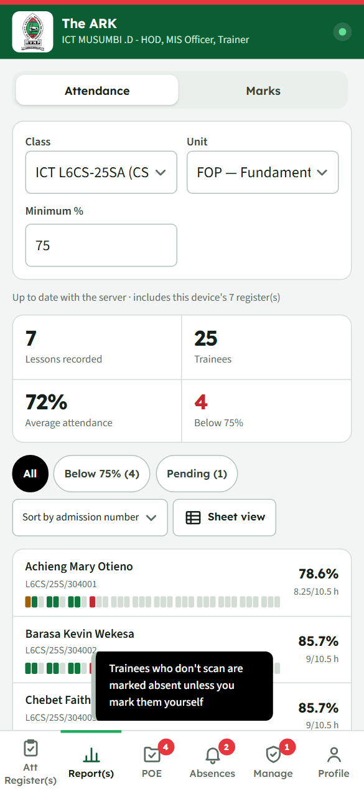

### 5.3 CAT registers

CAT and extra CAT attendance are listed in their own card under the term register. They do not count in the register's hours or percentage. Tap one to open it.

### 5.4 Export and print

| Button | Result |
|---|---|
| **Export Excel register** | RVNP's General Class Register template, filled in: crest and title block, lecturer, class, level, duration, subject, WK1–WK12, Possible and Actual hours, the % formula, and the lecturer's and HOD's comments. Pending students are tagged *(pending)*. |
| **Print or save PDF** | The same layout, to print or save as a PDF from the print dialog. |

### 5.5 Submit to the HOD

At the end of the term, add your comment under **HOD approval** and tap **Submit to HOD** (**Submit again** after a correction). The HOD's decision (approved or returned) and their comment appear in the same place.

### 5.6 An earlier term

Choosing an earlier term shows that term's register read-only, with a notice that it is **Locked**. The HOD and MIS Officer see an **Unlock for 7 days** button there (see [9.3](#93-unlocking-an-earlier-terms-registers-and-marks)).

---

## 6. Marks (continuous assessment)

Open **Report(s) → Marks** and choose the class and unit.

| Column | Meaning |
|---|---|
| **S/N** | Serial number in the order shown. |
| **Student** | Name, admission number and CDACC registration code (when uploaded). |
| **CAT 1–3** | Oral / theory marks, each a percentage (0–100). |
| **PRAC 1–3** | Practical marks, each a percentage (0–100). |
| **AVG** | The three added together and divided by 3. A CAT not done counts as 0. |

- Type a mark: it is **saved on this device as you type** and sent when there is internet. **Enter** moves down the column.
- A mark over 100 is shown in red and not saved.
- **Search** by name or admission number; **sort** by S/N, name or either average; 30 students to a page.
- **Export Excel marksheet** gives RVNP's *Continuous Assessment Marks Sheet per Unit of Competency*.
- **Send now** sends straight away instead of waiting.

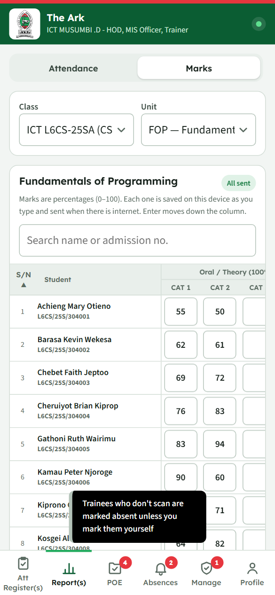

**One marksheet for the unit's whole life.** A unit that runs over several terms, even with different trainers, keeps CAT 1–3 and PRAC 1–3 on one sheet. Each mark remembers the term it was entered in.

**Locked marks.** Marks entered in a term that has ended show with a dashed border and cannot be changed. A notice above the table says which term they belong to; the HOD or MIS Officer can unlock them for 7 days from there.

Only the trainer of the unit (or the HOD) can change marks; others see them read-only.

---

## 7. POE evidence: reviewing students' work

Students send scanned CATs and practicals from their app. New documents are saved in **the student's own college Google Drive** and shared (view only) with the unit's trainer, the HOD, the MIS Officer and the college's backup account. Documents sent before version 4.16 stay in the college Drive. POE needs internet.

**Connect Google first (once).** To open documents in students' Drives, connect your college Google account in **Profile → Google account**. Students' documents are shared with that address. When your Google sign-in has run out (after about an hour), the preview shows **Sign in to Google**: tap it and carry on.

### 7.1 Trainers: review evidence

1. Open the **POE** tab. The dot shows how many submissions are waiting for you.
2. Use the chips (**To review**, **Approved**, **Returned**, **All**) and the class, unit and search filters.
3. Tap a submission to open it. The preview shows the student's name and the item (for example *CAT1*), their admission number, the unit and the version, and every page.
4. Choose **Approve**, or write a note and choose **Return to student** (a note is needed when returning).
5. After each decision the next waiting submission opens. **‹ Previous** and **Next ›** move through the list; **Open in Drive** opens the original file.

**Changed after sending.** The app remembers each document's fingerprint when it is sent. If the student changes the file in their Drive afterwards, the preview shows **This file was changed in the student's Drive after it was sent**, and the list marks it *changed after sending*. Check it carefully before deciding.

**"Not shared with you yet."** A document is shared with a unit's new trainer the next time the student's phone is online. If it says so, ask the student to open their app, and check that **Profile → Google account** shows your college address.

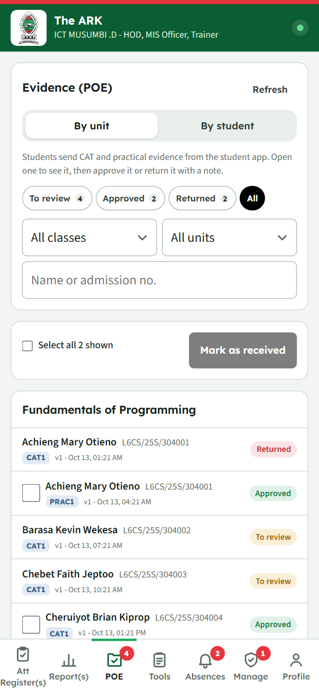
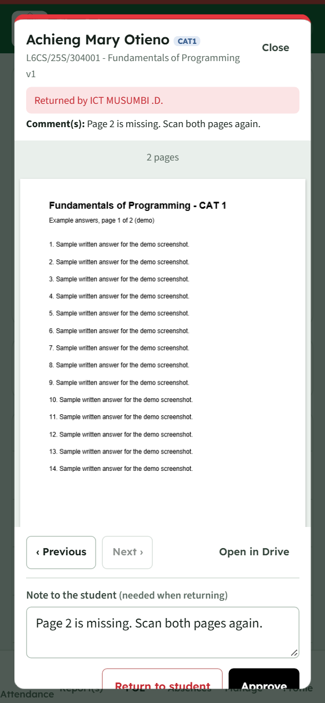

Previews open faster the second time: files you have opened are kept on the device, and the next submission is fetched while you read the current one.

You also see evidence for units you taught in earlier terms, read-only. Only the unit's current trainer (or, if it is not taught this term, the trainer who had it last) and the HOD can approve or return.

### 7.2 MIS Officer: receive approved evidence

Under **POE → To receive**, tick the approved submissions you have filed and tap **Mark as received**. They move to **Received**.

### 7.3 By student (HOD and MIS Officer)

Tap **By student** to see one class at a time as a table:

- The class line reads, for example, *ICT DICT-25S-RS2 (20 students, 5 units)*.
- Each row shows how many items the student has **sent**, **approved**, **with trainer** and **returned**. Filter with the chips (Everyone, With trainer, Returned, Has approved, Nothing sent) and the search box.
- Tap a student to open their units and items: **✓** approved, **•** with the trainer, **↺** returned, **–** not sent. Tap a mark to open that file.
- **Export Excel** and **Save as PDF** under the table give the whole filtered list.

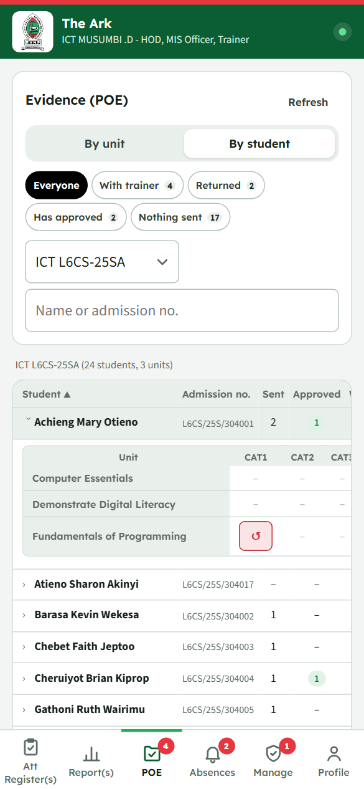

---

## 8. Absences (HOD and MIS Officer)

The **Absences** tab lists students who have missed more lessons of a unit than the limit you set.

1. Set **Tell me about students who have missed more than N lessons of a unit** and tap **Save**. The limit is shared by the HOD and MIS Officer (3 to start).
2. The tab's red dot shows how many students are over the limit.
3. The table shows each student and unit: class, unit, trainer, **Missed** (for example *5 of 18*) and **Attendance %**. A double lesson counts as two. Rows below 75% attendance are highlighted.
4. Filter by **class**, **search** by name, admission number, unit or trainer, and **sort** by any column.
5. Choose an earlier **term** to look back.
6. **Export Excel** or **Save as PDF** to share or print the list.

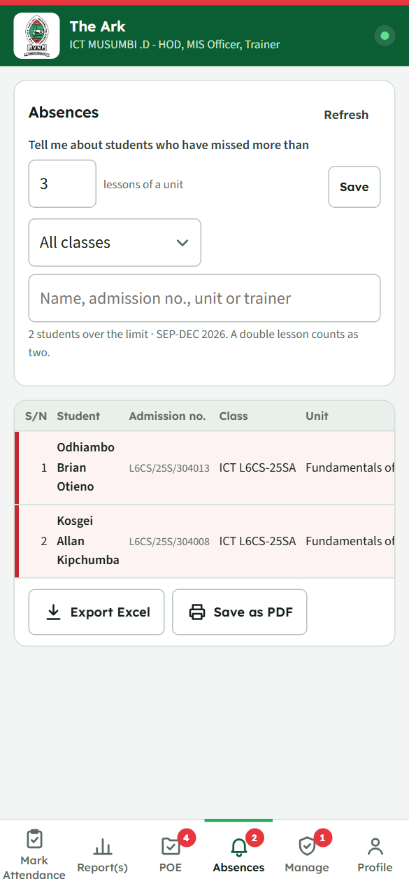

---

## 9. HOD tasks

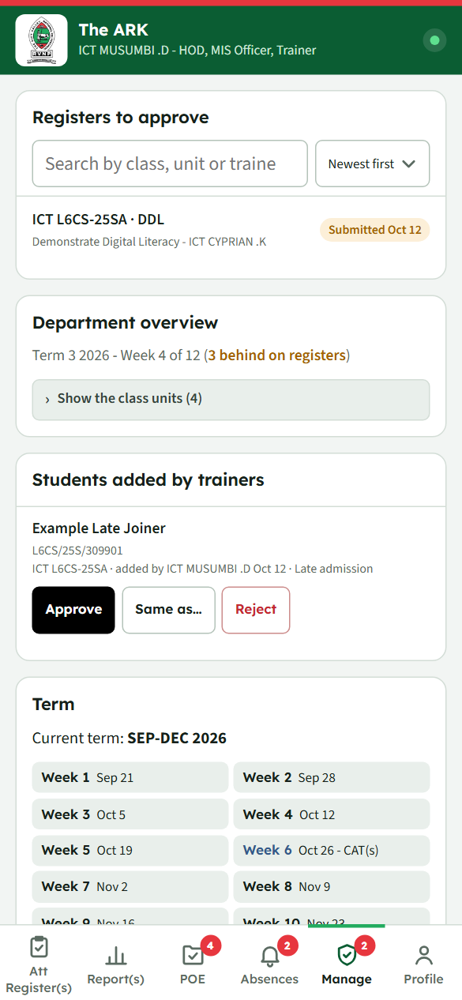

### 9.1 Registers to approve

**Manage → Registers to approve** lists the term registers trainers have submitted.

- **Search** by class, unit or trainer and **Sort** (newest first, oldest first, by class, by unit, by trainer). The list shows 30 at a time.
- Tap one to open the register, read it, add the HOD's comment, then **Approve register** or **Return to trainer** (returning needs a comment).
- Registers already decided are under **Approved or returned**.

### 9.2 Department overview

**Manage → Department overview** shows, for every class and unit in the loading: the trainer, lessons marked against lessons due so far, the last lesson marked, the attendance rate and the approval status. Rows that are behind on marking are highlighted.

- Tap **Show the class units** to open the table (it starts folded away).
- Tap a column heading to sort; choose a **Term** to look back.
- Tap a row to open that register in Reports.

### 9.3 Unlocking an earlier term's registers and marks

When a new term starts, every register and mark from the previous term is **locked**. To let a trainer correct one:

- **Registers**: open **Report(s)**, choose the earlier **Term**, the class and unit, and tap **Unlock for 7 days**. Tap **Lock again** when the correction is done.
- **Marks**: open **Report(s) → Marks** for the class and unit and tap **Unlock … for 7 days** in the notice above the table.

The unlock lasts 7 days, then the register locks again by itself. Registers that a device had not sent before the term ended are still accepted: only changes are locked.

### 9.4 Student phones (HOD and MIS Officer)

A student checks in and sends evidence only from the phone they set up, and only in the browser they set it up in. Another browser on the same phone counts as another phone. If a student:

- gets a new phone, or loses theirs,
- resets their phone or clears the browser's data, or
- needs to use a different browser,

they see *"already registered on another phone or browser"*. To free them:

1. Open **Manage → Student phones** and tap **Show registered phones**.
2. **Search** by name, admission number or class (tap a heading to sort).
3. Tap **Reset phone** on the student's row and confirm.

The next phone or browser the student sets up becomes theirs. Their old phone stops checking in. Their check-ins, evidence and attendance stay. Each reset is recorded with who did it and when.

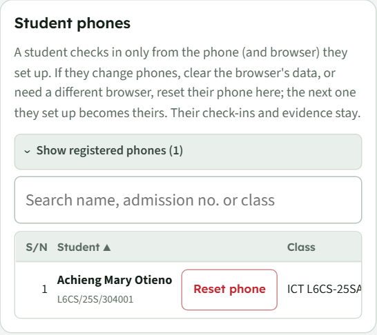

### 9.5 Backup of approved evidence (HOD and MIS Officer)

Students keep their documents in their own Drive, and a student's college account is removed when they leave. So approved documents are copied into the **backup account's** Drive (for example ictpoe@rvnp.ac.ke), in a folder called **The ARK - Archive**, sorted by class and student. Only the approved version is copied.

**Manage → Backup** shows:

- **How full the backup account's Drive is**, as a bar (for example *41 GB of 50 GB used*): the account's own use against the space typed in Manage → Google Drive.
- **The last backup**: how many documents were copied, how many had been changed by the student after sending, and how many could not be copied. **Try these again** retries the ones that failed (usually because the student deleted the file or stopped sharing it).
- How many approved documents are **waiting** for the next backup.

To back up:

- Tap **Back up now**. It starts within a few minutes; a large backup carries on over several runs.
- Or choose **Repeat** (every day, week or month) and the hour, and tap **Save**.

**When the Drive fills up.** From **80% full**, a warning appears here and a dot on the Manage tab, for the HOD and the MIS Officer. At **95%** backups stop, so the Drive never fills up halfway through. Then either:

- ask IT to give the backup account **more Google Drive space**, or
- **switch to another college account**: set up the Drive bridge under that account (Technical Documentation, 4.3) and change the **Backup account** in Manage → Google Drive. Copies already made stay in the old account.

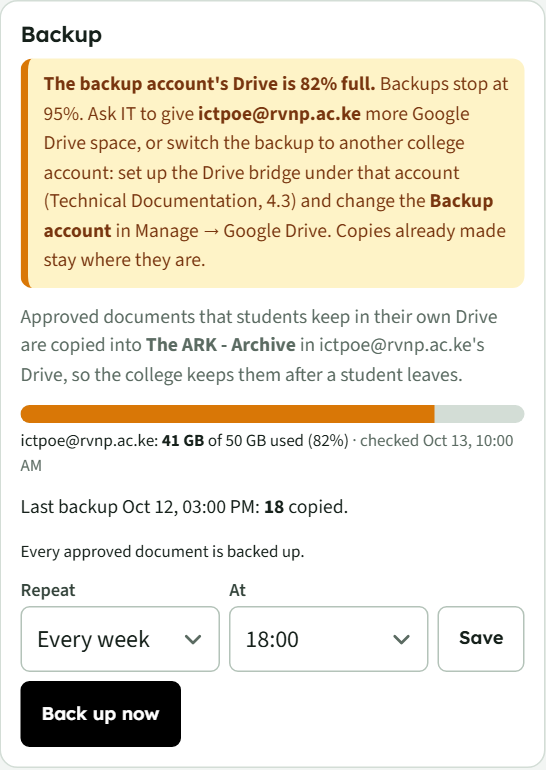

---

## 10. MIS Officer tasks

Sign in with your staff code and PIN. Everything below is under **Manage**. The first time on a new system, sign in with staff code `MIS` and the set-up PIN, then choose your own PIN (see the Technical Documentation).

### 10.1 Start of each term

**Term**
1. Enter the **name** (for example *Term 3 2026*), the **code** (*2026-T3*), the **duration** as printed on registers (*SEP-DEC 2026*) and the **first teaching day**.
2. Add any **break weeks** (any day in each break week).
3. Tick the **CAT weeks** (for example weeks 6 and 11). Trainers can take CAT registers only in these weeks.
4. Enter the **Assessment series** printed on marksheets (*Nov/Dec 2026*) and the **Hours per lesson** (for example *1.5*).
5. Tap **Save term**.

The app makes the **12 teaching weeks** and skips the breaks. The card then reads, for example, *Current term: SEP-DEC 2026*, with the weeks listed and CAT weeks marked *- CAT(s)*.

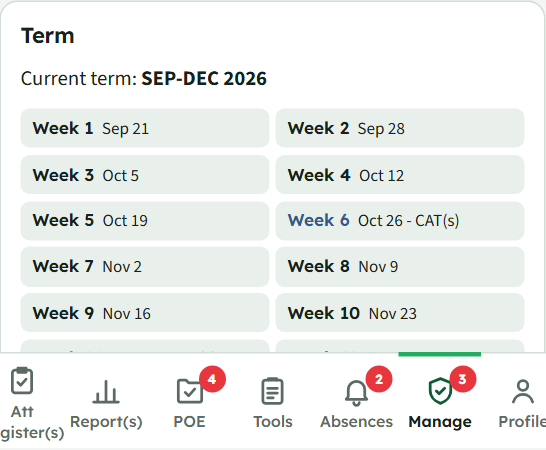

> **Saving a new code starts a new term and closes the old one.** All registers and marks of the old term are locked from that moment (see [9.3](#93-unlocking-an-earlier-terms-registers-and-marks)).

**Trainer loading**
1. Choose the department loading workbook (`.xlsm` or `.xlsx`). The app reads the **Subject Loading**, **List of Trainers** and **List of Subject** tabs.
2. Check the preview, then tap **Upload loading**. Every trainer gets an account; anyone listed as HOD gets the HOD role.

**Class lists**
1. Tap **Choose class register files** and pick one or more class register PDFs from the MIS system (the same register as Excel or CSV also works).
2. For each file the app reads the class code (for example *CSCL6-25-S-RS*) and every student, and ticks the streams in the loading the class belongs to (*ICT L6CS-25SA / SB / SC*).
3. Tap **Check changes** to see who is new, who is already on the list, names spelt differently, and anyone missing from the file.
4. For a class with streams, every student is listed with the stream they will go to. The first time, the list is divided into equal parts in list order (for example 82 students in 3 streams: 28, 27, 27). Tap **A / B / C** next to a student to move them, or **Split the list evenly again**.
5. Tap **Save class list**.

Uploading a newer list later keeps everyone in their stream; only new students are shared out. **Nobody is removed** unless you tick them as having left. Tap **Show the classes** to see every class with its streams and number of students, and tap a class to move a student between streams, or withdraw or restore them.

**CDACC registration codes**: tap **Upload registration codes** and choose any Excel or CSV with admission numbers and registration codes (a filled marksheet works).

### 10.2 Students added by trainers

These appear at the top of Manage. For each one:
- **Approve** adds them to the class (**Move here** if they are on another class's list);
- **Same as…** is for a typo or duplicate: their marks count for the student you pick;
- **Reject** leaves them out of that class's registers and reports.

A newer class list that includes a pending student confirms them automatically.

### 10.3 Staff and roles

Tap **Show the staff** to open the list. Each row shows the staff code and name, the role chips and the account buttons. Use **Search** and **Sort** (by name, staff code, role, or no PIN yet first).

| Task | How |
|---|---|
| **First-time PIN** | In the box at the top, enter 4 to 8 digits and tap **Set** (or **Change**). Anyone without a PIN of their own signs in with it and must then choose their own. Give it to staff privately; **Remove** stops it working. |
| **Reset a PIN** | Tap **Reset PIN** on the person's row. With a first-time PIN set, you can send them back to it (they choose a new PIN at their next sign-in), or issue a one-off PIN instead. A one-off PIN is shown **once**: give it to them privately. Only the MIS Officer can reset PINs. |
| **Roles** | Tick **Trainer**, **HOD** or **MIS Officer**. You cannot remove your own MIS role. |
| **Switch an account off** | **Switch off** signs them out on every device. **Switch on** restores the account. |
| **Add a staff member** | **Add a staff member**: staff code and name, then **Add and issue PIN**. |

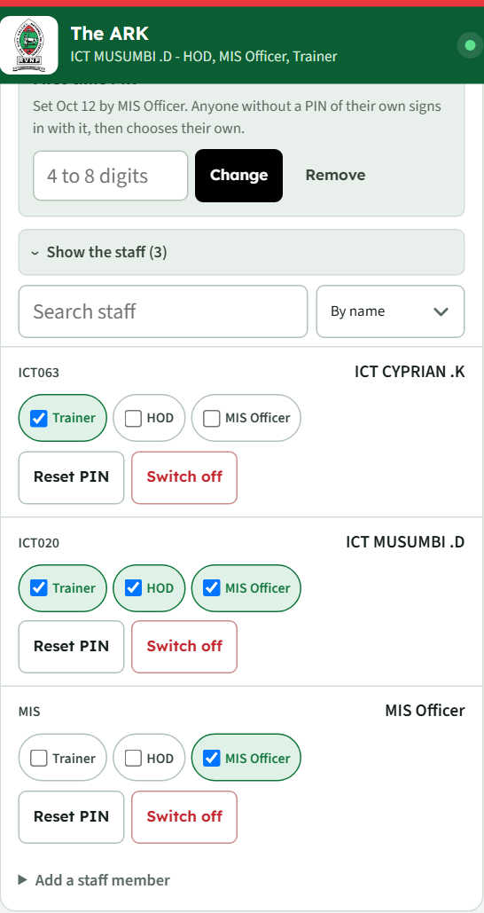

### 10.4 Archive or delete a class

When a class has finished:

1. Tap the class under **Class lists**, then **Archive**. It disappears from day-to-day screens with its students and loading. Nothing is deleted.
2. Archived classes are listed under **Archived classes**, where **Bring back** undoes the archive.
3. **Delete…** removes an archived class from the database for good: its students, loading in every term, registers, check-ins, marks, sign-offs and evidence records. You type the class name to confirm, and a file with everything being deleted is saved to your device first.

**The Google Drive copies are never touched**: attendance sheets, marksheets and students' evidence files stay in Drive.

### 10.5 Google Drive

**Manage → Google Drive** shows whether the Drive link is **Connected** and when it last updated.

Each trainer's Drive folder gets **Attendance register - <term>** and **Marksheets - <term>**, rewritten from the database within a few minutes of a change (edits made in the sheets are replaced). Evidence is stored as **POE / Class / Adm No - Name / Unit - CAT1 - v1.pdf**, listed in the sheet **POE - Evidence index**.

A folder is made automatically for every trainer in the loading who does not have one. You can also choose a trainer's folder or paste its link on this card.

Setting up the Drive link is a one-off job described in the Technical Documentation.

**Backup account.** Students' new documents are in their own Drives. Every one of them is also shared with the **Backup account** set on this card (for example ictpoe@rvnp.ac.ke), so the department can always see them; approved documents are copied into it by the backup (see [9.5](#95-backup-of-approved-evidence-hod-and-mis-officer)). It must be the account the Drive bridge runs as. Type the address and the **Space (GB)** the college gave that account (for example 50), then tap **Save**. The space is typed in because, with the college's shared (pooled) Google storage, Google reports only the whole college's total, not one account's allowance.

---

## 11. Your Profile

| Section | What you can do |
|---|---|
| **Name and roles** | Shows who is signed in. **Change PIN** and **Sign out** (signing out keeps everything on the device). |
| **How attendance is counted** | How much of a lesson a **Late** arrival and an **Excused** absence count for (50% and 100% to start); how many hours until a register **locks**; whether new registers start with **everyone present** or **everyone absent**. Tap **Save**. The Late and Excused shares apply to your units' reports and Excel registers, including the copies the HOD sees. |
| **Google account** | **Connect Google** with your college account, so students' POE documents are shared with you and you can open them. **Use another account** changes it. |
| **Class lists** | When registers were last sent, and when class lists were last downloaded. **Download class lists** fetches the latest now. **Student app link** shows a QR code and link for students to set up their app. |
| **Backup and transfer** | **Export backup** saves everything on the device to a file (useful before a long time offline or before changing phones). **Import backup** loads such a file on another device. **Erase this device** removes all data from this device (it warns you if any registers have not been sent). |

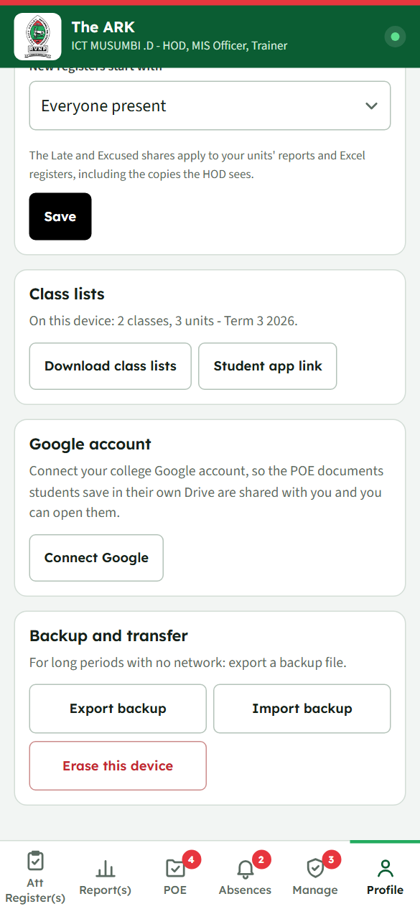

---

## 12. Students: the Student-POE app

### 12.1 Set up your device (once, with internet)

1. Open the student app address, or scan the **Student app link** QR code your trainer shows. Add it to your home screen (see [1.1](#11-install-the-app-on-your-phone)).
2. Choose your **class** (as on the MIS class list, for example *CSCL6-25-S-RS*), then your **name**.
3. Tap **Register this device** and confirm.

Your device is now **registered to you**: it checks in only you, and you check in only from this device. A registered device cannot be switched to another student. Another browser on the same phone counts as another device. If you change phones, clear the browser's data or need another browser, ask the HOD or MIS Officer to reset your phone.

The header shows **Student-POE**, your name and class (for example *Adaki Bwire Ryan - ICT L6CS-24M*), whether you are online, and **Send** with the number of check-ins waiting.

Your **profile** shows your name, admission number, the college crest, and your **Student QR ID**: your trainer can scan it to mark your attendance.

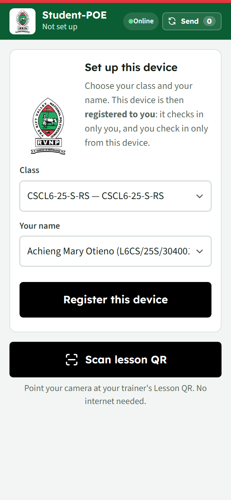
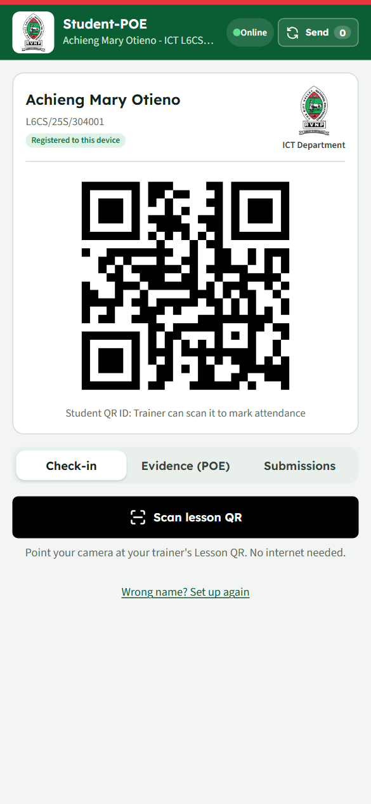

### 12.2 Check in to a lesson

1. On the **Check-in** tab, tap **Scan lesson QR** and point the camera at your trainer's **Lesson QR**. You can also use your normal camera app.
2. You see **Attendance recorded**. No internet is needed: the check-in is saved on your device and sent automatically when you are online (or tap **Send**).

If a check-in is refused, the app says why:

| Message | Meaning |
|---|---|
| Not your class | The code is for another class. |
| Code not valid | The code was expired or not from your trainer. |
| This device is registered to another student | Only the registered student can check in on this device. |
| You are registered on another phone or browser | Ask the HOD or MIS Officer to reset your phone (Manage → Student phones). |
| You are not on the class list any more | See your trainer. |

### 12.3 Send POE evidence

On the **Evidence (POE)** tab:

**Connect Google Drive (once).** Your documents are saved in your own college Google Drive, in a folder called **The ARK - POE**, and shared (view only) with your trainer. Tap **Connect Google Drive** and sign in with your **college Google account** (@rvnp.ac.ke), then allow what Google asks. The app can only see the files it saves there. A personal Gmail account is not accepted.

1. Choose the **Unit**. Units from earlier terms are marked *(earlier term)*.
2. Tap one or more **items** (CAT1–CAT4, PRAC1–PRAC3). An item already sent shows ✓ approved, • with your trainer, or ↺ returned.
3. For each item, add the pages. **Every submission needs at least 2 pages.**
   - **Take photo of a page** opens the camera **inside the app** (allow the camera the first time). Hold the page flat inside the dashed frame, in good light, and tap the round button.
   - The app finds the page edges; drag the corners if needed, or use **Rotate** or **Whole photo**. **Retake** goes back to the camera.
   - **Keep and take the next page** saves the page and goes straight back to the camera for the next one. **Keep page** saves it and stops; **Done** closes the camera.
   - **From gallery or PDF**: choose photos, or a PDF of at least 2 pages.
   - Move pages with **↑ ↓** or delete one with **✕**.

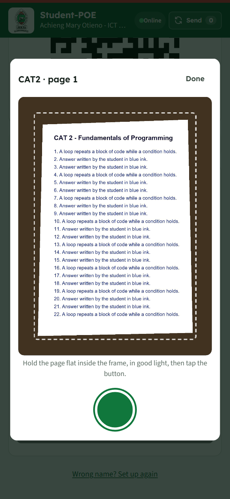
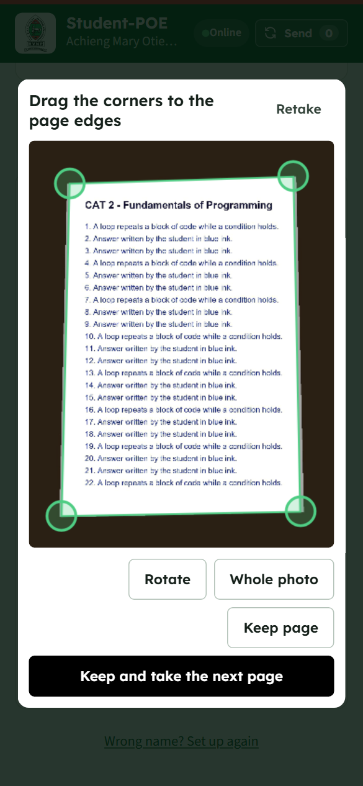
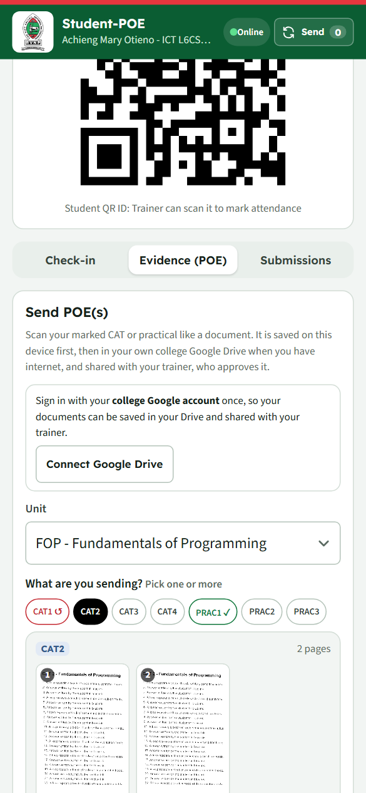

4. Tap **Save and send**. The PDF is saved on your device first, then saved in your Google Drive and shared with your trainer when you have internet.
   - Google asks you to sign in again after about an hour. If a document says **Sign in to Google to send it**, tap **Sign in to Google and send**.
   - Do not change or delete your POE files in Drive: your trainer is told if a file changed after it was sent.

Files can be up to 20 MB. If the camera inside the app cannot start on a device, the app says so and the next tap on **Take photo of a page** uses the phone's own camera app instead.

**Get told when your evidence is decided.** Under the Save button, turn on **Notify me about my evidence**. Your device then tells you when your trainer approves your work or sends it back, with their comment; tapping the message opens the app on Submissions.
- **Android**: works straight away.
- **iPhone**: first add the app to the Home Screen from Safari and open it from there (iOS 16.4 or later).
- If the switch is not shown, the college has not switched notifications on yet.

### 12.4 Submissions

The **Submissions** tab has three blocks. Tap a heading to open or close it. **My POE submissions** and **My attendance** are tables: type in **Search**, narrow them down with the choices beside it (status; unit and mark), and tap a column heading to sort (tap again to reverse). Long tables show 30 rows at a time. **My scanned check-in(s)** has its own **Sort**.

| Block | What it shows |
|---|---|
| **My POE submissions** | Each piece of evidence with its unit, item, version and status: *Saved on device — sends when online*, *With your trainer*, *Approved* or *Returned*. A returned item shows **Comment(s):** with your trainer's note, and **Scan again** to send a new version (v2, v3…). **Save a copy** saves the PDF to your device. |
| **My scanned check-in(s)** | Your QR check-ins and whether each is *Confirmed*, *Sent — waiting for trainer to sync*, *Saved on device* or not accepted. |
| **My attendance** | Every lesson your trainers marked, with your mark, and a summary of lessons present, late, absent and excused with your percentage. It is updated whenever you are online, and kept on your device as your own copy. |

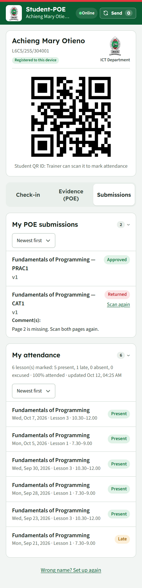

---

## 13. Working offline and keeping data safe

- **Everything is saved on the device first**: registers, marks, check-ins and scanned evidence. There is no time limit: data waits until the device is online, and signing out keeps it.
- **Automatic sending** happens whenever the device is online. Nothing needs to be tapped.
- **Warnings**: trainers see a warning when registers have waited 2 days or more; students when check-ins have waited 3 days or more.
- **Install the app** (add it to the home screen): the browser then keeps its data permanently.
- **Backups**: trainers can **Export backup** under Profile at any time.

**What can still lose unsent data**: clearing the browser's data or uninstalling the browser; on an iPhone, not opening the app for 7 days unless it was added to the Home Screen; and losing the device before it has synced.

**Needs internet**: signing in for the first time, setting up a student device, POE (uploading and previewing), Manage, Absences, and looking at earlier terms.

---

## 14. Troubleshooting and questions

| Problem | What to do |
|---|---|
| **"No classes for you yet"** | Connect to the internet and tap **Profile → Download class lists**. If it stays empty, the MIS Officer needs to upload the loading. |
| **A class has no students** | The MIS Officer needs to upload that class's register with the right stream ticked. |
| **"Your sign-in has ended"** | Your PIN was changed or your account was switched off. Sign in again; nothing is lost. |
| **"No PIN has been set for this staff code yet"** | Ask the MIS Officer for a PIN, or for the first-time PIN. |
| **Locked out after wrong PINs** | Wait 15 minutes, or ask the MIS Officer to reset your PIN. |
| **A register will not change** | It is locked: give a reason when asked, or, for an earlier term, ask the HOD or MIS Officer to unlock it. |
| **"That day has not come yet"** | Future days cannot be marked. |
| **A slot cannot be chosen** | It is a future day, lunch for a lesson, or outside the teaching weeks; or the unit already has 3 lessons that week. |
| **The app looks old after an update** | Close the app completely and open it again while online. It updates itself. |
| **A student's check-in says "waiting for trainer to sync"** | It is confirmed once the trainer's device has sent the lesson. |
| **A student changed phones, or wants another browser** | The HOD or MIS Officer taps **Reset phone** for them in **Manage → Student phones** ([9.4](#94-student-phones-hod-and-mis-officer)). |
| **"Unable to complete previous operation due to low memory"** | Chrome closed while the phone's camera app was open. Update the app (it now uses its own camera, which avoids this) and take the pages with **Take photo of a page**. |
| **POE says it needs internet** | Evidence lives in Google Drive; connect and try again. |

---

## 15. Asking for a change to a screen

Add **`?notes=1`** to either app's address, for example https://musumbidenis.github.io/tt/?notes=1.

1. A strip appears at the top. While **Pick** is on, tap anything on the screen and type what you want changed (or tap one of the ready phrases such as *Bigger* or *Move it up*), then **Save**.
2. Turn **Pick** off to move around the app normally, then back on to carry on.
3. **Copy** gives one block of text listing every note, ready to send to whoever maintains the app.

Anything typed into the app's own boxes is never included, but words printed on the screen are (for example a student's name on a register row), so trim those out before sending. **Close** puts the page back to normal; **Clear** forgets your notes.
